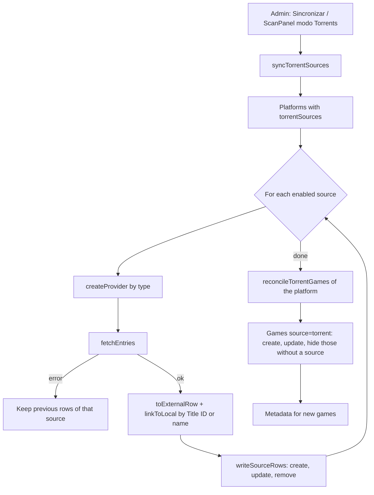
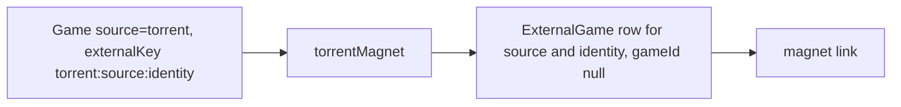
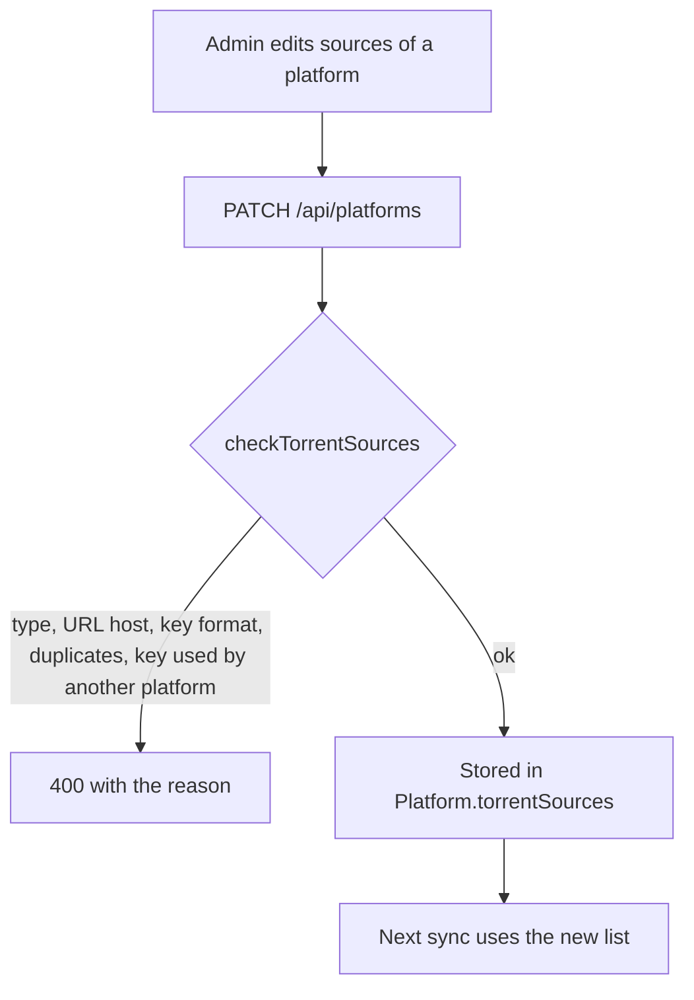

# Torrent sources

Games that GameHub lists as torrents come from external sources. Each platform
declares its sources in Admin → Settings, in `Platform.torrentSources`. A source
only says where the list is and how to read it; the code only knows the source
types.

- Source types and factories: `src/lib/external/sources.ts` (`createProvider`)
- Types, validation and parsing: `src/lib/external/source-types.ts`
- Sync and reconciliation: `src/lib/external/torrents.ts`
- Magnet lookup: `src/lib/external/magnet.ts`
- Admin editor: `src/components/admin/SettingsForm.tsx` (Fuentes de torrents)
- API: `PATCH /api/platforms` (validates `torrentSources`), `POST /api/admin/external/sync`

## Configuration

Each entry of `Platform.torrentSources`:

| Field | Meaning |
|---|---|
| `key` | identity of the source. Lowercase, digits and hyphens, unique across platforms. Immutable: it is part of the stored `externalKey` of each game. |
| `type` | `json-list` (JSON array of entries) or `minerva-directory` (Minerva Archive directory page) |
| `url` | `https` URL on the type's host (`raw.githubusercontent.com`, `minerva-archive.org`) |
| `enabled` | disabled sources are not read and do not count toward games |

The position in the list is the priority: when two sources have the same game,
the first enabled one wins, unless the game keeps the source it already had.

## Flows

### Sync (admin button or scan with mode "Torrents")

### Magnet lookup (game page)

### Admin edit

## Behaviour to know

- Disabled or removed sources are ignored by reconciliation. Their games that
  have no other source are hidden, not deleted.
- Rows of removed sources stay in `ExternalGame` until they are deleted by hand.
  Whether removing a source also deletes its rows is an open decision.
- A platform whose `torrentSources` is `[]` has no torrents; the scan job reports
  that instead of syncing.
